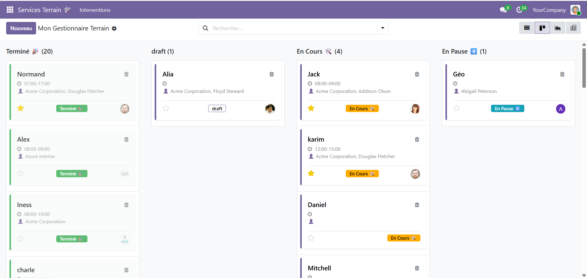
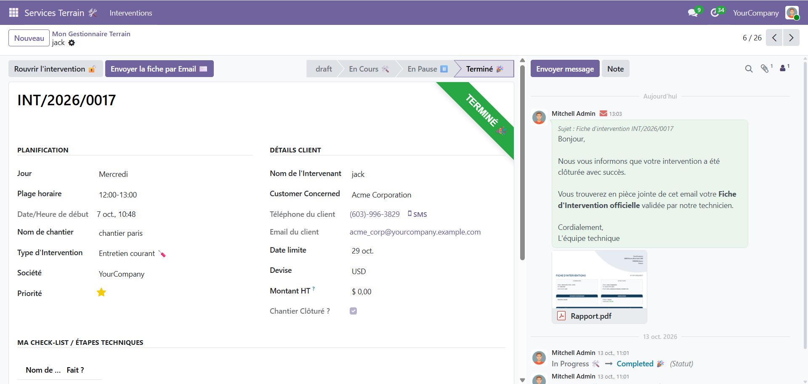
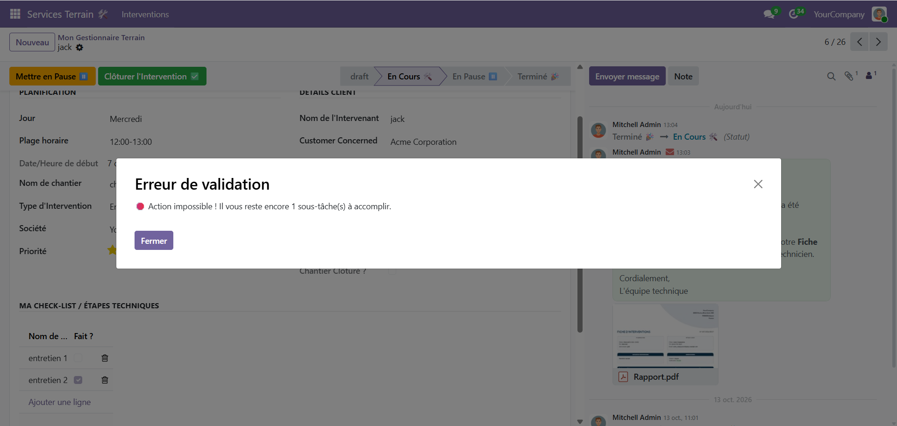
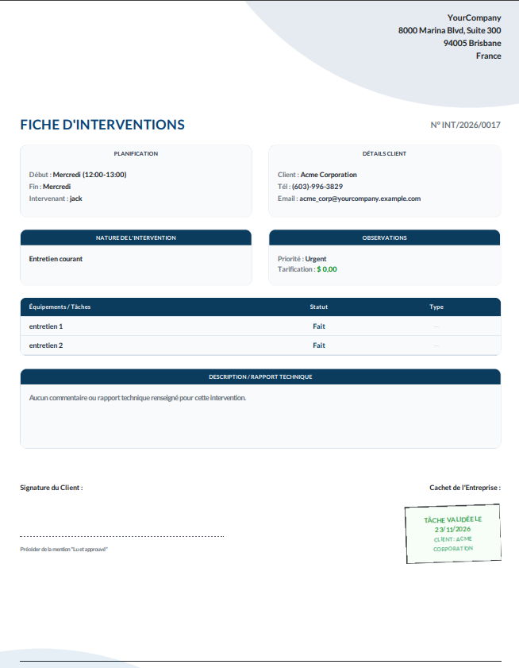

# 🔧 Odoo 19 - Gestion des Interventions Terrain (Field Service)

Module personnalisé développé sous **Odoo 19** dédié à la gestion complète des chantiers et interventions terrain (secteur plomberie / maintenance).

## ✨ Fonctionnalités Principales

* **Workflow complet d'intervention :** Suivi de l'état du chantier depuis la création jusqu'à la confirmation finale, avec contrôles conditionnels et alertes automatiques.
* **Checklist qualité :** Validation obligatoire des points de contrôle avant la clôture d'une intervention.
* **Multi-devis & Multi-société :** Gestion adaptée aux structures multi-entités avec génération de devis multiples liés au chantier.
* **Reporting PDF personnalisé :** Génération de bons d'intervention et rapports QWeb incluant un tampon/signature stylisé.
* **Communication client :** Envoi automatisé d'emails de suivi et de confirmation via des modèles d'emails (`mail.template`).
* **Analyse & Pilotage :** Vues Kanban, Pivot, Graphique et Recherche avancée pour le suivi de l'activité.
* **Internationalisation (i18n) :** Traduction complète en Français (`fr`) et Anglais (`en_US`).

## 🛠️ Architecture Technique

* **Version Odoo :** 19.0
* **Backend :** Python (ORM Odoo, contraintes métier, séquences automatiques `ir.sequence`)
* **Vues & Rapports :** XML, QWeb Reports
* **Sécurité :** Groupes utilisateurs dédiés (`security/field_service_security.xml`) et règles d'accès (`ir.model.access.csv`)

## 📸 Aperçu de l'application

### 1. Pilotage de l'activité (Vue Kanban)
*Suivi visuel de l'avancement des chantiers par étape, assignation des techniciens et alertes visuelles en temps réel.*


### 2. Gestion détaillée d'une intervention & Checklist qualité
*Fiche complète du chantier avec gestion multi-devis, suivi des étapes du workflow et checklist de contrôle obligatoire.*


### 3. Contrôles métier & Validation de clôture
*Vérification automatique des conditions avant confirmation finale et déclenchement de l'envoi d'email au client.*


### 4. Bon d'intervention PDF (QWeb)
*Génération automatique d'un rapport client prêt à imprimer, incluant les détails de l'intervention et le tampon officiel de l'entreprise.*



## 🚀 Installation

1. Cloner ce dépôt dans votre répertoire `custom_addons` :
   ```bash
   git clone https://github.com
   ```
2. Redémarrer le serveur Odoo et mettre à jour la liste des applications.
3. Rechercher **Field Service** et cliquer sur **Installer**.

---
*Développé par Takwa — Ingénieure Informatique & Développeuse Odoo*
